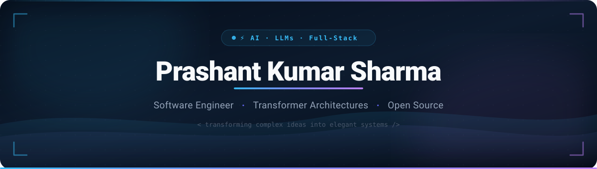

<div align="center">

<!-- ═══════════════════════════════ HEADER ═══════════════════════════════ -->


<!-- ─── Animated Typing ─── -->


<br/>

<!-- ─── Contact Badges ─── -->
<a href="mailto:prashantkr.sharma07@gmail.com">
  
</a>
&nbsp;
<a href="https://github.com/CrazyPrash007">
  
</a>
&nbsp;
<a href="https://www.linkedin.com/in/YOUR_HANDLE">
  
</a>
&nbsp;


</div>

<br/>

<!-- ════════════════════════════ ABOUT ME ═══════════════════════════════ -->

## 💫 About Me

```javascript
const prashant = {
  name       : "Prashant Kumar Sharma",
  pronouns   : "He/Him",
  languages  : ["Python", "C++", "TypeScript", "JavaScript", "Bash"],
  domains    : ["Large Language Models", "Full-Stack Engineering", "Robotics & Simulation"],
  exploring  : "Transformer internals · Attention mechanisms · MoE architectures",
  building   : "Intelligent systems that are fast, clean, and production-ready",
  motto      : "Transforming complex ideas into elegant, efficient software 🚀"
};
```

<table>
<tr>
<td>

🔭 &nbsp;**Diving deep into** Transformer internals, LLM fine-tuning & high-performance computing  
💡 &nbsp;**Engineering passion** for scalable backends, clean APIs & distributed systems  
🤝 &nbsp;**Open to collaborate** on AI/ML research, open-source & challenging engineering projects  
🏫 &nbsp;**Background** in Inter-IIT tech, drone simulation (ArduPilot + Gazebo) & telemedicine platforms  
💬 &nbsp;**Ask me about** Python · C++ · Django · Transformers · System design  
📬 &nbsp;**Reach me at** [prashantkr.sharma07@gmail.com](mailto:prashantkr.sharma07@gmail.com)

</td>
<td align="center">

```
📊 Quick Facts
━━━━━━━━━━━━━━━━━━━━
⚡ Languages   : 5+
🔧 Frameworks  : 7+
🌍 Projects    : 10+
☕ Coffee/day  : ∞
```

</td>
</tr>
</table>

<br/>

<!-- ════════════════════════════ TECH STACK ══════════════════════════════ -->

## 🛠️ Tech Stack

<div align="center">

### Languages

&nbsp;&nbsp;


---

### AI & Machine Learning

&nbsp;&nbsp;


---

### Frameworks & Web

&nbsp;&nbsp;


---

### Tools & Infrastructure

&nbsp;&nbsp;


</div>

<br/>

<!-- ═══════════════════════════ FEATURED WORK ════════════════════════════ -->

## 🚀 Featured Projects

<div align="center">

| 🏗️ Project | 📝 Description | 🔧 Stack |
| :--- | :--- | :--- |
| [**LLM Exercises**](https://github.com/CrazyPrash007/CrazyPrash007/blob/main/1_llm/part1_EXERCISES.ipynb) | Hands-on Transformer & LLM implementation from M2L Summer School | `Python` `PyTorch` `Colab` |
| [**prepAThon**](https://github.com/CrazyPrash007/prepAThon) | Inter-IIT preparation platform with scalable backend | `Flask` `JavaScript` `REST API` |
| [**TelMedSphere**](https://github.com/CrazyPrash007/TelMedSphere) | Open-source telemedicine web application | `Django` `TypeScript` |
| [**Gazebo Drone Sim**](https://github.com/CrazyPrash007/Gazebo-Drone-Simulation-in-Ardupilot) | Autonomous drone simulation in ArduPilot & Gazebo | `C++` `ROS` `ArduPilot` |
| [**WebOS**](https://github.com/CrazyPrash007/WebOS) | Browser-based OS experience with CI/CD pipelines | `JavaScript` `GitHub Actions` |

</div>

<br/>

<!-- ════════════════════════════ GITHUB STATS ════════════════════════════ -->

## 📊 GitHub Stats

<div align="center">


&nbsp;&nbsp;


<br/><br/>


<br/><br/>


<br/>

<details>
  <summary><b>🏆 GitHub Trophies &nbsp;—&nbsp; click to expand</b></summary>
  <br/>
  
</details>

</div>

<br/>

<!-- ═══════════════════════════════ SNAKE ════════════════════════════════ -->

## 🐍 Contribution Snake

<div align="center">
  <picture>
    <source media="(prefers-color-scheme: dark)"  srcset="https://raw.githubusercontent.com/CrazyPrash007/CrazyPrash007/output/github-contribution-grid-snake-dark.svg"/>
    <source media="(prefers-color-scheme: light)" srcset="https://raw.githubusercontent.com/CrazyPrash007/CrazyPrash007/output/github-contribution-grid-snake.svg"/>
    
  </picture>
</div>

<br/>

<!-- ═══════════════════════════ CONNECT ══════════════════════════════════ -->

## 🌐 Let's Connect

<div align="center">

<a href="mailto:prashantkr.sharma07@gmail.com" target="_blank">
  
</a>
&nbsp;
<a href="https://github.com/CrazyPrash007" target="_blank">
  
</a>
&nbsp;
<a href="https://www.linkedin.com/in/YOUR_HANDLE" target="_blank">
  
</a>

<br/><br/>

<sub>⚡ Crafted with passion &nbsp;•&nbsp; © Prashant Kumar Sharma &nbsp;•&nbsp; <i>Always building, always learning.</i></sub>

</div>
